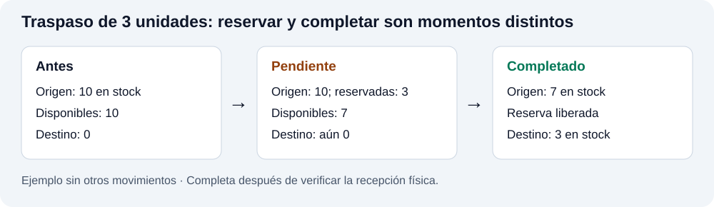
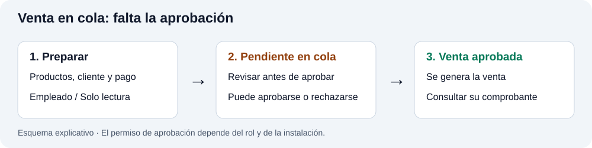
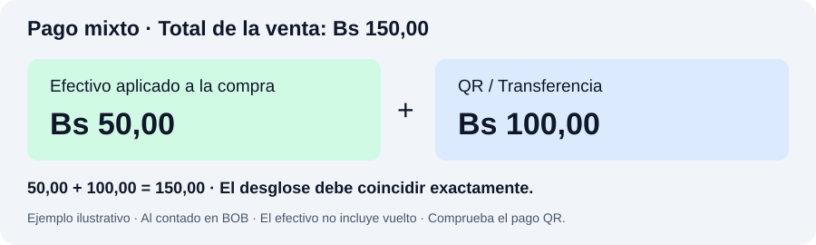

# PICLA · Manual de usuario por módulos y roles

Guía de operación de todos los módulos y submódulos del sistema. Se centra en reglas, efectos y situaciones que requieren criterio; omite instrucciones evidentes de formularios y navegación. Revisión: 26 de octubre de 2026.

> Las imágenes son esquemas explicativos con datos de ejemplo, no capturas del sistema. Las opciones disponibles dependen del rol y de las funciones habilitadas en la instalación.

## 1. Responsabilidades por rol

| Rol | Alcance principal | Límites que conviene recordar |
| --- | --- | --- |
| Administrador | Administración completa, inventario, ventas, caja, créditos, reportes, auditoría y configuración. | Las correcciones de ventas y movimientos conservan sus propias restricciones. |
| Encargado | Ventas directas, aprobación de cola, anticipos, entregas, devoluciones, caja, cotizaciones y créditos. Consulta productos. | Solicita correcciones de caja y aprobación de abonos. Sin administración de inventario, usuarios o sueldos. |
| Empleado | Prepara ventas en cola, atiende operaciones de POS habilitadas, abre/cierra caja, realiza cotizaciones y solicita abonos. Consulta productos. | No completa ventas directas ni convierte cotizaciones. Puede aprobar la cola según los permisos instalados. No registra movimientos manuales de caja. |
| Solo lectura | Consulta productos, categorías, kits e historial de ventas; prepara ventas en cola. | No completa ni aprueba ventas, no opera caja ni créditos. Su nombre no excluye el envío a cola. |

Que aparezca un enlace no garantiza permiso para operar: algunas pantallas tienen restricciones adicionales. Los módulos administrativos de Gestión y Reportes están reservados al administrador en la navegación actual.

## 2. Acceso y cambio de contraseña

- Si se exige cambiar la contraseña al ingresar, ese cambio debe completarse antes de trabajar. La nueva debe tener al menos ocho caracteres.
- En el cambio voluntario se verifica la contraseña actual y la nueva debe ser distinta. La recuperación por correo depende de la dirección asociada al usuario.
- «Credenciales inválidas o usuario no permitido» requiere revisar también el estado de la cuenta con el administrador, no solo la contraseña.
- Si aparece «La contraseña fue actualizada, pero no se pudo actualizar el estado», la clave ya cambió: informa el mensaje antes de repetir el proceso.

## 3. Panel principal

**Rol: administrador.** Resume ventas, métodos de pago y productos destacados. Las tarjetas y gráficos pueden cubrir períodos distintos —por ejemplo, últimos siete días o semana—; compara siempre el mismo período con los reportes.

Úsalo para detectar variaciones y abrir el módulo correspondiente. Una cifra de ventas no representa por sí sola el efectivo disponible en caja, la ganancia ni la deuda pendiente.

## 4. Inventario

**Administración: administrador.** Encargados y empleados consultan Productos; Solo lectura también consulta Categorías y Kits. Antes de cualquier movimiento, comprueba la sucursal: un producto puede tener precios y existencias diferentes en cada una.

### 4.1. Productos

Distingue **costo**, **precio de venta**, **precio para kit** y **rango de cotización**: cumplen funciones diferentes. El porcentaje máximo de cotización debe ser al menos 100%; el mínimo no debe superar al máximo. Los niveles de mayoreo comienzan desde dos unidades.

Si el sistema encuentra el artículo en el catálogo, revisa la coincidencia antes de crear otro: puede bastar con incorporarlo a la sucursal y definir allí precio y stock. La modalidad de seguimiento distingue productos sin seguimiento, por lote o por serie; compruébala antes de registrar unidades.

**Carga masiva:** usa la plantilla Excel/CSV y revisa la vista previa. Las filas necesitan nombre, categoría, costo y precio para ser consideradas válidas. Tras un error, comprueba qué productos ya se guardaron antes de reenviar todo el archivo.

**Exportaciones:** el reporte de control omite precios y usa existencias físicas; otras variantes usan disponibilidad. Elige el de control para un conteo físico y evita interpretar una reserva como una pérdida.

### 4.2. Categorías

Organizan el catálogo y los filtros. Revisa los productos asociados antes de renombrar, desactivar o eliminar una categoría. Si una categoría deja de aparecer entre las disponibles, comprueba su estado antes de crear otra con un nombre equivalente.

### 4.3. Kits

Un kit reúne componentes, cantidades y precios de kit; revisa el conjunto, no solo su nombre. Al editar se conserva su código. Su disponibilidad depende de los componentes.

En el POS puede ajustarse la composición antes de agregarlo. Las líneas del kit se conservan separadas de los productos individuales: el mismo artículo en ambos lugares puede representar una compra intencional o una duplicación accidental.

### 4.4. Ingresos

Registra reposición de mercadería con referencia y proveedor para poder rastrearla. La confirmación muestra un **costo promedio ponderado** entre las unidades existentes y las nuevas; las unidades reservadas también forman parte de las existencias físicas usadas en el cálculo.

**Ejemplo:** 10 unidades a Bs 20 más 5 a Bs 26 dan un costo promedio de Bs 22. Revisa el costo aceptado antes de confirmar: influye en la valoración del inventario. Para ingresos en USD, verifica moneda y tipo de cambio.

### 4.5. Salidas

Se usan para descontar inventario por ajustes y otros motivos operativos. Identifica la causa y la referencia. Si corresponde una devolución, anulación de venta o traspaso, utiliza ese flujo para conservar la relación con el movimiento original y evitar un segundo descuento.

### 4.6. Traspasos

Hay traspasos unitarios y masivos. Al registrarlos quedan **pendientes** y reservan unidades en origen; al completarlos se mueve el stock al destino. En los masivos, revisa la cantidad acumulada de cada producto, aunque figure en varias líneas.

Completa después de verificar la recepción física. La confirmación contempla al administrador o a la sucursal destino, según el acceso habilitado. No registres además un ingreso manual por la misma mercadería.

### 4.7. Importación de catálogo

Sincroniza productos entre sucursales; permite ajustar precios manualmente o por porcentaje. El ajuste porcentual se aplica a las filas seleccionadas tomando como base los precios de origen.

- **Sin stock:** incorpora o actualiza el catálogo; no representa un envío físico.
- **Con stock:** puede añadir existencias a productos ya presentes en destino. Revisa las cantidades antes de repetir una importación.
- **Conflicto de código:** si identifica productos distintos, unifica los códigos antes de importar; no fuerces la coincidencia.
- **Importación de imágenes:** compara por nombre y puede actualizar otras sucursales, no solo el destino del catálogo. Revisa nombres iguales que pudieran corresponder a artículos distintos.

Si el proceso se interrumpe, revisa el destino: algunos productos pueden haberse sincronizado antes del error.

### 4.8. Anulaciones

Este submódulo resuelve **traspasos**, no ventas. La acción depende del estado:

| Acción | Estado necesario | Efecto |
| --- | --- | --- |
| Anulación | Pendiente | Cancela y libera la reserva; no mueve stock. |
| Devolución | Completado | Descuenta en destino y devuelve stock al origen. |
| Reposición | Devuelto | Vuelve a descontar en origen y enviar a destino. |

El motivo es obligatorio. Si el traspaso no aparece, comprueba su estado: cada acción muestra únicamente los compatibles.

### 4.9. Historial de traspasos

Reúne eventos de traspasos, anulaciones, devoluciones y reposiciones. Para reconstruir un caso, sigue la referencia y su secuencia de acciones, además de origen, destino y fechas. Varias filas pueden pertenecer al mismo traspaso; no son necesariamente envíos adicionales.

### 4.10. Historial de inventario

Muestra **cortes de existencias tomados al abrir y cerrar caja**. El detalle describe ese momento, no el stock actual. Compara cortes de la misma sucursal y distingue apertura de cierre; la ausencia de un corte no demuestra que el inventario estuviera vacío.

### 4.11. Control

Compara la cantidad registrada con el conteo físico. **Registrar el control y aplicar el ajuste son decisiones distintas:** sin ajuste se documenta la diferencia; con ajuste se modifica el inventario. Revisa producto, sucursal y motivo antes de aplicarlo, especialmente si hubo ventas o traspasos durante el conteo.

### 4.12. Recuperar productos

Restaura artículos desactivados en su sucursal. Recuperar permite volver a utilizarlos; no equivale a registrar una compra ni justifica añadir unidades. Después, verifica estado, precios y existencias antes de vender.

### 4.13. Matriz de precios

Compara precios del mismo producto entre sucursales y permite editar cada celda. **El cambio se guarda al salir de la celda**: comprueba la columna y el mensaje de confirmación. Un valor inválido se restaura; si falla el guardado, vuelve al precio anterior.

## 5. Punto de Venta

### 5.1. Ventas

Administrador y encargado completan ventas directas; empleado y Solo lectura las envían a cola. La aprobación crea la venta: **«Venta en cola» no es un comprobante de venta completada**. Administrador, encargado y empleado pueden ver acciones de aprobación, sujetas a permisos instalados.

Para venta al contado puede usarse cliente identificado o venta anónima. Para crédito se necesita cliente. Los cambios de precio requieren estar habilitados y respetar el rango permitido; si el sistema ajusta el precio, revisa nuevamente el total.

**Pago mixto:** al contado en BOB, con efectivo y QR/transferencia. Ambos importes deben ser positivos, tener hasta dos decimales y sumar exactamente el total. Registra efectivo aplicado a la compra, excluyendo el dinero que se devuelve como vuelto.

Mostrar el QR no demuestra el ingreso del dinero: verifica el pago antes de confirmar. Las ventas en cola no admiten crédito.

### 5.2. Historial de Ventas

Distingue las pestañas de ventas y cola. Antes de repetir una operación tras un error, busca su referencia, fecha, importe y estado. El comprobante sirve para identificar la venta al tramitar una devolución o corrección.

**Modificar venta —administrador:** compara total anterior, nuevo y diferencia; indica motivo y confirma dinero adicional recibido o devuelto, con su desglose por método. Aplica a ventas completadas al contado; créditos, anticipos y ventas con factura fiscal tienen restricciones. No puede eliminar todas las líneas ni alterar libremente unidades ya devueltas. Si otra operación cambió la venta, recarga el detalle antes de corregirla.

### 5.3. Anulación Ventas

**Administrador.** Cancela la venta mediante su operación específica. Revisa estado, devoluciones anteriores y reintegro antes de confirmar. Si solo regresa una parte de la mercadería, utiliza Devoluciones. Conserva el motivo para que la operación pueda explicarse en auditoría.

### 5.4. Venta Adelantada

Registra anticipo y deja mercadería pendiente de entrega. Separa **total vendido**, **anticipo recibido** y **saldo por cobrar**: no son el mismo importe. Revisa cliente y referencia al atender el saldo; no crees una segunda venta para representar la entrega de la primera.

### 5.5. Por Entregar

Permite entregas parciales y finales. Registra las cantidades realmente retiradas; el resto debe permanecer pendiente. Saldo monetario y cantidad pendiente se revisan por separado.

**Forzar entrega completa —administrador:** marca todos los ítems pendientes. Úsalo después de comprobar la entrega total; no sirve para ocultar una diferencia de inventario.

### 5.6. Devoluciones

Trabaja sobre la venta original y la cantidad que efectivamente regresa. Comprueba devoluciones previas para no reintegrar dos veces. En pagos mixtos, el sistema calcula el reparto por método; revisa ese desglose antes de devolver dinero.

## 6. Caja

**Apertura y cierre:** administrador, encargado y empleado. El fondo inicial debe corresponder al dinero real. Al cierre, compara esperado con contado y documenta cualquier diferencia. El cierre automático, cuando está activado, no sustituye la comprobación física del dinero.

**Movimientos manuales:** administrador y encargado registran ingresos/egresos con su causa. Comprueba primero si la venta, devolución o pago ya generó el movimiento para no duplicarlo.

**Correcciones:** el encargado solicita cambios; el administrador edita y revisa solicitudes. Una solicitud pendiente no significa que el movimiento ya se haya corregido.

**Interpretación:** cobros por QR y efectivo se muestran separados. El total comercial de ventas no equivale al efectivo que debe estar en el cajón. Un cierre conserva su corte; compara movimientos dentro de la sesión correspondiente.

## 7. Cotizaciones

### 7.1. Cotización

Prepara una propuesta con vigencia y precios dentro del rango autorizado. Comprueba vencimiento antes de comprometer el precio al cliente. Guardar una cotización no significa haber completado una venta ni cobrado. Si se alcanza el límite de cotizaciones activas, revisa las pendientes y anula solo las que ya no correspondan.

### 7.2. Historial de Cotizaciones

Permite revisar estado, anular y convertir en venta. **Solo administrador y encargado convierten**; deben comprobar stock, vigencia, cobro y caja abierta. Conserva el comprobante resultante y evita registrar otra venta por la misma propuesta. Si falla la conversión, revisa el estado antes de repetirla.

## 8. Créditos

### 8.1. Nuevo Crédito

Abre el POS con la modalidad crédito; no es un formulario independiente de deuda. La venta a crédito directa corresponde al administrador o encargado. Requiere cliente y vendedor responsable; pago inicial entre cero y el total, plazo mayor a cero y recordatorio entre hoy y vencimiento.

El límite de créditos abiertos/vencidos se aplica por cliente. Revisa su cartera antes de comprometer otro crédito; no dupliques al cliente para eludir el límite.

### 8.2. Cartera

Permite consultar deuda por cliente y estado. Distingue **total original**, **abonado** y **saldo pendiente**. Para responder cuánto debe alguien, usa el saldo actualizado; para explicar cómo se llegó a él, consulta los pagos y el historial de cobros.

### 8.3. Pagos

El administrador registra abonos directamente; encargado y empleado envían solicitudes para aprobación. Verifica cliente, crédito, fecha, monto y método antes de registrar o aprobar.

**«Solicitud enviada» todavía no es un abono registrado.** Confirma su aprobación y presencia en el historial antes de considerar reducida la deuda. No vuelvas a enviar el mismo cobro mientras está pendiente.

### 8.4. Alertas

Son recordatorios de vencimiento. Atender o marcar una alerta como vista no cobra ni cancela la deuda. Comprueba el saldo en Cartera y registra el cobro por Pagos. Su frecuencia depende de la configuración de recordatorios.

### 8.5. Historial de cobros

Reconstruye movimientos de créditos por cliente, sucursal y fechas. Úsalo para comprobar un abono y explicar diferencias de saldo. Si el cobro no aparece, revisa si aún es una solicitud pendiente antes de repetirlo.

## 9. Gestión

**Rol: administrador.**

### 9.1. Usuarios

Asigna rol, sucursal y estado activo según la función de cada persona. Sin sucursal, el usuario operativo puede quedar sin inventario o ventas visibles. Revisa el acceso después de una reasignación.

Al crear una cuenta, comprueba si el correo de recuperación fue enviado y conserva la referencia de las credenciales temporales cuando corresponda. Una cuenta creada no significa necesariamente que su correo se haya entregado. Prefiere revisar el estado activo cuando se retira acceso, antes de decidir eliminar el registro.

### 9.2. Dispositivos

Consulta sesiones por usuario, dispositivo y estado. Identifica la sesión concreta antes de cerrarla: un trabajador puede tener varias. Cerrar una sesión retira ese acceso; no desactiva por sí mismo toda la cuenta.

### 9.3. Clientes

Mantiene la identidad utilizada en ventas y créditos. Busca por documento antes de crear otro registro; dos fichas de una misma persona dificultan conciliar su deuda. La baja de esta pantalla inactiva al cliente: no equivale a cancelar sus operaciones ni sus obligaciones pendientes.

### 9.4. Sucursales

Cada sucursal agrupa usuarios y operaciones, con precios e inventario propios. Cambiar su nombre no mueve mercadería ni reasigna usuarios. Antes de eliminar, revisa las relaciones existentes; si el sistema lo impide, solicita revisión de esas dependencias.

### 9.5. Planilla de Sueldos

Programa sueldos recurrentes y registra sus pagos. **Crear una planilla no significa pagarla.** Confirmar un pago genera historial y actualiza la próxima fecha. Revisa el período y el último pago antes de repetirlo.

Desactivar una planilla detiene su estado activo; no borra los pagos históricos. Editar monto o próxima fecha requiere comprobar qué pagos ya fueron registrados.

## 10. Reportes

**Rol: administrador en la navegación actual.** Antes de comparar o exportar, iguala sucursal, fechas y criterio. Un archivo exportado conserva la consulta realizada en ese momento.

### 10.1. Ganancias

Calcula ganancia como precio de venta menos precio de compra. No la interpretes como saldo de caja ni como utilidad neta después de todos los gastos. Compara el período y los desgloses por día, sucursal y método.

Una venta mixta puede participar en dos métodos de cobro. No sumes sus conteos como si fueran ventas diferentes; usa el conteo general de ventas.

### 10.2. Capital

Resume capital invertido en inventario, valor de venta y ganancia potencial por sucursal. **Ganancia potencial** supone vender las existencias; aún no es dinero cobrado.

#### Capital → Categorías

Agrupa la inversión para detectar dónde se concentra el inventario. Compara categorías bajo la misma sucursal y alcance antes de decidir una reposición.

#### Capital → Productos

Desglosa la inversión por artículo. Sirve para identificar productos con capital acumulado, stock bajo o sin existencias y contrastarlos con su movimiento comercial. Valor de costo y valor de venta responden a preguntas distintas.

### 10.3. Productos más vendidos

El ranking se presenta por ingresos. No significa necesariamente mayor cantidad de unidades ni mayor margen. Revisa unidades e importes antes de usarlo para planificar compras.

### 10.4. Cuentas por Cobrar

Distribuye saldos en vigente, 1–30, 31–60, 61–90 y más de 90 días. Prioriza el seguimiento según antigüedad y monto. No confundas deuda vigente con deuda vencida ni este saldo con ventas realizadas en un período.

### 10.5. Sueldos

Muestra gasto en sueldos **pagados** durante el período. Una planilla programada que aún no se pagó no representa el mismo concepto. Para investigar una diferencia, contrasta el reporte con el historial de pagos de Gestión → Planilla de Sueldos.

## 11. Auditoría

**Rol: administrador.** Permite rastrear eventos, entidades, acciones y usuarios. Investiga combinando referencia, usuario, fecha y sucursal; revisa la secuencia completa para distinguir la operación original de sus correcciones.

Consultar auditoría no revierte nada. La solución se registra en el módulo que originó la operación, conservando su motivo.

## 12. Configuración

**Rol: administrador.**

- **Datos generales, moneda y tipo de cambio:** revisa su efecto antes de usarlos en nuevas operaciones. Cambiar el tipo de cambio no es una corrección individual de una venta anterior.
- **Créditos y recordatorios:** define límite de créditos abiertos/vencidos por cliente, día semanal y umbral de alerta diaria. Cambiar estos valores no registra pagos ni elimina deudas.
- **Precios en el POS:** habilita ajustes para todos los roles que acceden al POS, dentro de los límites del producto. Es un permiso general; revisa los rangos antes de activarlo.
- **QR de cobro:** admite PNG, JPG o WebP de hasta 2 MB. **Se guarda automáticamente al seleccionar el archivo.** Verifica que corresponda al destinatario correcto; quitarlo deja al POS sin esa imagen disponible.
- **Información del sistema:** ofrece datos de referencia y recuentos. Una diferencia de cifras requiere revisar alcance y actualización, no modificar registros para igualarlos.

## 13. Errores y recuperación

| Situación | Acción recomendada |
| --- | --- |
| Sin productos o ventas visibles | Revisa sucursal y filtros. Si falta asignación, el administrador debe corregirla en Usuarios. |
| Permiso insuficiente o acceso restringido | Deriva al rol correspondiente; si debería estar permitido, solicita revisión de permisos. |
| Caja cerrada | Comprueba la sesión y sucursal; revisa si hubo cierre automático antes de abrir la correspondiente. |
| Stock insuficiente | Actualiza la consulta y distingue stock físico, reservado y disponible. Revisa otras operaciones antes de ajustar existencias. |
| Importación interrumpida | Consulta qué productos, imágenes o unidades ya se guardaron. Reintenta solo lo pendiente. |
| Traspaso ausente en Anulaciones | Comprueba si su estado corresponde a anulación, devolución o reposición. |
| Precio restaurado o fuera de rango | Revisa el valor aceptado, los límites y el permiso de cambio antes de confirmar el total. |
| Pago mixto inválido | Usa efectivo y QR distintos, positivos y con hasta dos decimales; deben sumar el total exacto. |
| QR no carga | Vuelve a abrir el cobro. Si persiste, pide revisar la imagen de Configuración; no confirmes un pago sin comprobarlo. |
| Cotización vencida o límite alcanzado | Revisa vigencia y pendientes. Anula solo las que ya no correspondan; solicita revisión si continúa el bloqueo. |
| Cliente alcanzó el límite de créditos | Revisa créditos activos y vencidos y pagos pendientes de aprobación antes de ofrecer otro crédito. |
| Venta creada, pero falló el crédito o el marcado de entrega | **No repitas la venta.** Conserva el comprobante y solicita regularizar el crédito o la entrega pendiente. |
| Venta registrada, pero el POS no actualizó | Guarda la referencia, recarga y busca en historial antes de registrar otra. |
| Venta cambió durante una modificación | Recarga su detalle y vuelve a evaluar la diferencia; otra operación pudo alterarla. |
| Solicitud de abono o corrección sin efecto | Comprueba su estado de aprobación. Pendiente no significa aplicada. |
| Función no disponible o error de instalación | Informa pantalla y mensaje al administrador; algunas funciones necesitan una actualización habilitada. |
| Conexión perdida o resultado incierto | Busca primero la operación en historial o cola. Comunica hora, sucursal, referencia y mensaje exacto si no puedes confirmar el resultado. |

**Antes de repetir cualquier operación que mueva dinero o stock, verifica si ya quedó registrada.**
